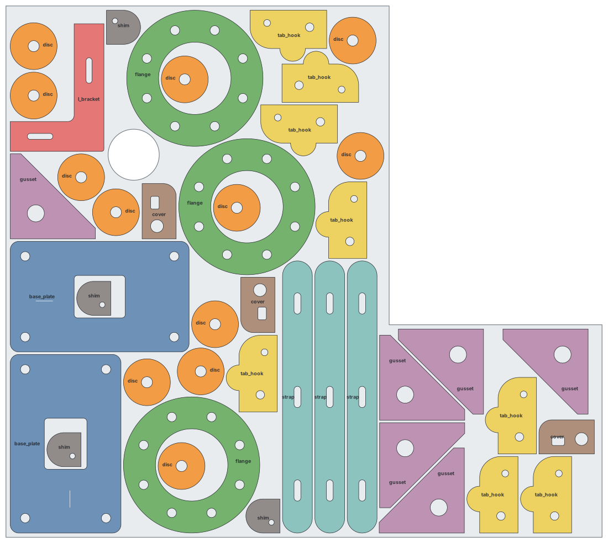

# sheetnest

[](https://github.com/azmtkrdnv/sheetnest/actions/workflows/ci.yml)

[](LICENSE)

True-shape nesting engine for sheet metal and plate, aimed at plasma and laser cutting.
It runs on its own (command line or Python library) and is meant to sit behind a thin
CAD add-in, such as a SolidWorks add-in that exports flat patterns.

**What it does**

- Reads DXF (and DWG via the ODA converter), SVG, STEP/IGES flat patterns, JSON polygons, and BOM CSV files.
- Nests true shapes using no-fit polygons. Small parts go inside the holes of large ones (part-in-part).
- Supports free or limited rotations, mirroring, spacing and edge margin.
- Nests on several sheet sizes and on irregular remnants with defects. Parts are grouped by material and thickness.
- Optimizes part order and rotations within a time limit, on several CPU cores.
- Writes per-sheet DXF files with true arcs and CAM layers, plus SVG previews and an HTML report.
- Writes JSON and CSV for ERP use or a CAD add-in, and suggests a reusable offcut.
- Writes plasma/laser G-code with true G2/G3 arcs and tangential lead-ins. Holes are cut before outlines, and parts nested in holes are cut first.
- Every result is checked against the real (un-inflated) geometry before it is written.



*The example job: 42 parts on an irregular remnant, avoiding the notch and an old hole. Discs sit inside the
flanges and shims inside the base-plate cut-outs. The full output, including G-code and the HTML report, is in
[`examples/sample_output`](examples/sample_output).*

## Install

```bash
git clone https://github.com/azmtkrdnv/sheetnest.git
cd sheetnest
pip install -e .            # core
pip install -e ".[step]"    # + STEP/IGES import (OpenCascade, ~100 MB)
pip install -e ".[dev]"     # + pytest
```

Python 3.9 or newer. Runs on Windows, Linux and macOS. Without the `step` extra, STEP files are
skipped with a warning when a job marks them `optional: true` (as the example job does).

## Quick start

```bash
python examples/make_samples.py                    # regenerate sample parts (optional, they're committed)
sheetnest inspect examples/parts/*.dxf             # check how files are read

# nest files directly; quantities come from ":N" or from the file name (_Q12 / x12)
sheetnest quick examples/parts/*.dxf flange.dxf:12 \
    --sheet 3000x1500x10 --spacing 6 --margin 10 -t 20 \
    --gcode generic_plasma --feed 2400 -o out/

# or run a full job file (sheets, remnants, materials, G-code settings)
sheetnest run examples/job.yaml -o out/
```

Open `out/report.html` to see every sheet with utilization, pierce points, cut length and estimated time.

## Job file

`examples/job.yaml` is a complete, commented example. In short:

```yaml
settings: {spacing: 6, margin: 10, rotations: [0, 90, 180, 270], time_limit: 20, part_in_part: true}
sheets:
  - {name: R17 remnant, file: stock/remnant_R17.dxf, quantity: 1, material: S235, thickness: 5}
  - {width: 3000, height: 1500, quantity: 20, material: S235, thickness: 5}
parts:
  - {folder: parts, pattern: "*.dxf", material: S235, thickness: 5}     # qty from file names
  - {file: parts/mount_plate.step, quantity: 6, rotations: [0, 180]}    # grain direction
  - {bom: bom.csv}                                                      # file,quantity,material,...
output:
  gcode: {post: linuxcnc_qtplasmac, feed: 2400, kerf: 1.6, kerf_mode: controller}
  cut: {lead_in: 5, lead_type: arc}
```

## Python API

```python
from sheetnest import load_parts, Part, Sheet, NestSettings, nest, validate
from sheetnest.export import export_all, OutputOptions

parts = [Part(g, quantity=10, material="S235", thickness=5) for g in load_parts("bracket.dxf")]
sheets = [Sheet(3000, 1500, quantity=5, material="S235", thickness=5)]
result = nest(parts, sheets, NestSettings(spacing=6, margin=10, time_limit=15))

print(result.summary())
assert validate(result) == []
export_all(result, "out", OutputOptions(gcode={"post": "generic_plasma", "feed": 2400}))

for layout in result.layouts:                 # raw placements
    for p in layout.placements:
        print(result.parts[p.part].name, p.x, p.y, p.rotation, p.mirror)
```

Placement convention: placed part = `rotate(mirror_x(part), rotation°)` about the origin, then translated by `(x, y)`.
The part origin is the lower-left corner of its bounding box as imported.

## Inputs

| Format | Notes |
|---|---|
| DXF | LINE, ARC, CIRCLE, LWPOLYLINE/POLYLINE with bulges, SPLINE, ELLIPSE, block INSERTs. Loose entities are chained into contours (gap tolerance `join_tol`). Layers matching `*BEND*`, `*DIM*`, `*TEXT*` and similar are ignored. `*ETCH*` and `*MARK*` layers become marking geometry. `$INSUNITS` is honored (inch files are converted to mm). Several outlines in one file become several parts. |
| DWG | Needs the free ODA File Converter installed. |
| SVG | Lines and circular arcs stay exact. Béziers are flattened. Physical units are converted to mm. |
| STEP / IGES | Flat parts only: export the flat pattern. The largest planar face is used, circular edges stay arcs, and thickness is detected. |
| JSON | `{"outer": [[x, y, bulge?], ...], "holes": [...], "circles": [[cx, cy, r]]}` |
| CSV BOM | Columns `file, quantity[, material, thickness, rotations, mirror, priority, name]` |

Register more formats with `sheetnest.register_importer(".ext", func)`.

## Outputs

| File | Content |
|---|---|
| `sheet_NN.dxf` | Layers `SHEET`, `CUT_OUTER`, `CUT_INNER`, `MARK`, `LABELS`, `REMNANT`. True arcs and circles, ready for SheetCam, LightBurn, ProNest and similar CAM software. |
| `sheet_NN.nc/.ngc/.tap/.gcode` | G-code (optional) |
| `sheet_NN.svg`, `report.html` | Previews and the visual report |
| `result.json` | Placements, per-sheet statistics, part list |
| `parts.csv`, `sheets.csv` | Tables for ERP or spreadsheets |

**G-code post-processors:** `generic_plasma`, `linuxcnc_qtplasmac`, `mach3_plasma`, `grbl_laser`.
They are plain template dictionaries in `sheetnest/export/gcode.py`; copy one to match your controller.

Cutting rules applied:
- Outlines are cut clockwise and holes counter-clockwise.
- Lead-ins are tangential arcs, or straight lines, on the scrap side. They are shortened automatically when space is tight, and pierce at the center of small round holes.
- Holes are cut before the outline. A part nested in a hole is cut before that hole.
- Rapid moves are ordered nearest-neighbor.

**Kerf:** `kerf_mode: controller` emits G41/G40 so the controller compensates. With `none`, the torch follows the drawn line.

## How it works

1. **Prepare.** Each part is flattened from outside, so the polygon always covers the real part. It is then inflated by half the spacing. One shape is kept for every allowed rotation and mirror, and duplicates of symmetric parts are removed.
2. **No-fit polygons.** For each pair of shapes, the engine computes the region where the second shape would collide with the first (Minkowski sum via Clipper, integer math). Holes are carved back out wherever the second shape fits inside them. Results are cached.
3. **Greedy placement.** For each part, the valid region is the sheet's inner-fit polygon minus all no-fit polygons. The engine picks the vertex of that region that grows the used sheet length least, staying left, then low. Parts that don't fit wait for the next sheet. Gravity `left` keeps the remnant on the right.
4. **Optimization.** The engine starts from several ordering heuristics (largest area, longest side, ...). It then runs simulated annealing over part order, rotation pinning and scoring weights until `time_limit`, with independent searches on each core. The cost is the area of all full sheets plus the used fraction of the last one.
5. **Validate and export.** The real geometry is re-checked for overlaps, spacing and margin.

Typical speed: one full layout of about 300 parts takes about 0.5 s once the no-fit polygons are cached. A 10–30 s optimization explores a few hundred layouts.

## Driving it from SolidWorks (or any CAD)

Keep the add-in thin:
1. Walk the assembly or BOM.
2. For each sheet-metal body, export the flat pattern to DXF. In the SolidWorks API this is `ExportToDWG2` with the sheet-metal option.
3. Read material and thickness from custom properties.
4. Write a job JSON with the same structure as the YAML.
5. Run `sheetnest run job.json -o out/`.
6. Read `out/result.json` back to show sheets, utilization and missing parts, or to open `report.html`.

The engine never runs inside SolidWorks, so a long nest or a crash can't take the CAD session down.

## Limitations / roadmap

Not yet included:
- Common-line cutting
- Bridges and micro-joints
- Geometric kerf offset (use controller compensation)
- Remnant database and inventory
- Interactive GUI
- Collision-avoiding rapid moves

Very large jobs (thousands of parts per sheet) would benefit from moving the no-fit polygon and placement core to C++ or Rust. The Python API would stay the same.

## Contributing

Bug reports with a sample file are very welcome; see [CONTRIBUTING.md](CONTRIBUTING.md).

```bash
pip install -e ".[dev]"
pytest -q
ruff check .
```

## Safety

sheetnest generates G-code for cutting machines. Always check programs in your controller's
preview or simulator and do a dry run before cutting. The software is provided without warranty
(see the license).

## License

[MIT](LICENSE) © 2026 Azamat Kardanov
